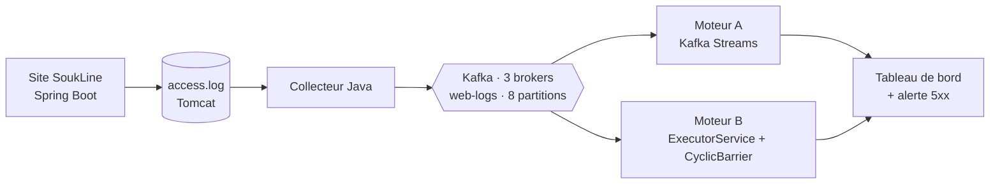

# 👋 Salut, je suis Bilal Jellaoui

### Étudiant en Master **Big Data, IA & Applications Avancées** (2025–2027)
Université Ibn Tofaïl · Faculté des Sciences de Kénitra 🇲🇦

*AI · Deep Learning · NLP · Big Data & Streaming — I build data-driven systems from raw data to deployment.*

 

🎯 **À la recherche d'un stage de PFE de 6 mois, à partir de février 2027** (Machine Learning · NLP/LLM · Data Engineering)

---

## 🙋 À propos de moi

- 🎓 Étudiant en Master **Big Data, IA & Applications Avancées** (Université Ibn Tofaïl, Kénitra)
- 🤖 **Machine Learning & Deep Learning** : CNN, Transformers, classification, détection de fraude
- 🧠 **NLP & LLM** : classification d'intentions, détection d'émotions, réponses générées par LLM (Llama 3.3 via Groq)
- 🗄️ **Big Data & Data Engineering** : streaming Kafka et Kafka Streams, Hadoop, HBase, HDFS, Hive
- ☕ **Développement** : Python, Java, Spring Boot, Flask, API REST
- 👥 **Travail en équipe** : chef d'équipe d'un projet à 6 (Git, Pull Requests, CI)
- 📅 **Disponible pour un PFE de 6 mois à partir de février 2027**

---

## 🧰 Technologies et outils

**🤖 IA, Machine Learning & Deep Learning**  

**🧠 NLP & LLM**  

**📊 Data Analysis & BI**  

**🗄️ Big Data & Streaming**  

**☕ Backend & Applications**  

**🛠️ DevOps, qualité & outils**  

---

## 🚀 Mes projets

### 🎓 Projets Master — Big Data, IA & Applications Avancées

### ⭐ Projet Master à la une : SoukLine, détection de pannes web en temps réel

> **Comment surveiller un site web en direct à partir de ses logs, et être alerté en quelques secondes quand les erreurs 5xx explosent ?**
> Réponse : un vrai site e-commerce, un cluster Kafka à 3 brokers, et deux moteurs de calcul indépendants dont les résultats sont comparés.

| | |
|---|---|
| 🧭 **Mon rôle** | Chef d'équipe (6 membres). Conception et développement du **Parser** de logs (regex, normalisation des URL) et du **Moteur A** (Kafka Streams : fenêtres de 5 s, temps d'événement lu dans le log, tolérance aux retards). Montage du **Moteur B** en binôme. Organisation du dépôt : Maven multi-modules, branches, Pull Requests, relecture obligatoire, intégration continue GitHub Actions. |
| ⚙️ **Ce que j'ai mis en œuvre** | Traitement en continu avec **Kafka Streams** ; concurrence Java écrite à la main (`ExecutorService`, `ConcurrentHashMap`, `AtomicLong`, `CyclicBarrier`) ; cluster Kafka KRaft répliqué (3 brokers) ; tests JUnit ; démonstration sur un **vrai site**, pas sur des données fabriquées. |
| ✅ **Résultats** | Les deux moteurs donnent les **mêmes totaux** par URL et par fenêtre (aux quelques secondes de publication près). En démonstration, une panne simulée sur `/checkout` (HTTP 503) fait passer le taux d'erreurs 5xx à **25 %** et déclenche l'**alerte** en quelques secondes ; le système revient à l'état normal dès la réparation. Un module de vérification séquentiel indépendant recompte les logs et compare les deux moteurs. |
| 🧰 **Technologies** | `Java 17` `Spring Boot` `Apache Kafka` `Kafka Streams` `Docker` `Maven` `JUnit 5` `GitHub Actions` `JMeter` |

 Le tableau de bord détecte la panne : 10 requêtes sur 10 en erreur sur <code>/checkout</code>, soit 25 % de 5xx pour un seuil de 10 %.

#### Autres projets Master

| Projet | Description | Technologies |
|---|---|---|
| 🧠 **[BMA — Mental Health Support Chatbot](https://github.com/Bilal-Jellaoui/BMA-Mental-Health-Chatbot)** | Chatbot de soutien en santé mentale : classification d'intentions et d'émotions (DistilBERT fine-tuné), réponses empathiques via LLM, **détection de crise avant chaque réponse**, mémoire de conversation, dashboard d'humeur et API REST. Projet d'équipe.  📄 [Rapport](https://github.com/Bilal-Jellaoui/BMA-Mental-Health-Chatbot/blob/main/Article(AI%20Mental%20Health%20Support).pdf) · 🖼️ [Captures](https://github.com/Bilal-Jellaoui/BMA-Mental-Health-Chatbot/tree/main/screenshots). | `Python` `Flask` `DistilBERT` `PyTorch` `Groq API` `SQLite` |
| 🛡️ **[Détection de fraude bancaire](https://github.com/Bilal-Jellaoui/fraud-detection-flask-ml)** | Application Flask de détection de fraude par carte : 4 modèles comparés sur données très déséquilibrées (0,17 % de fraudes), SMOTE, XGBoost retenu (**ROC-AUC 0,982**, F1 0,87), API REST et dashboard d'erreurs. Projet individuel.  📄 [Rapport (8 p.)](https://github.com/Bilal-Jellaoui/fraud-detection-flask-ml/tree/main/report) · 🖼️ [Captures](https://github.com/Bilal-Jellaoui/fraud-detection-flask-ml/tree/main/docs) | `Python` `Flask` `XGBoost` `scikit-learn` `SQLite` |
| 🗜️ **[Compression adaptative de signaux physiologiques multi-capteurs](https://github.com/Bilal-Jellaoui/adaptive-physiological-signal-compression)** | Comparaison d'algorithmes de compression sur des signaux physiologiques multi-capteurs (**ECG, EEG, SpO2, respiration**) et **sélection adaptative** de l'algorithme selon le signal, par une approche métaheuristique. Volume de données ciblé : 1 à 2 Go. | `Python` `Métaheuristique` `Traitement du signal` |
| 🗄️ **[HBase — Workload & Storage Optimization](https://github.com/Bilal-Jellaoui/HBase-Workload---Storage-Optimization)** | Analyse des métriques HBase, **détection des points chauds** (hotspots) et rééquilibrage des ressources. **HDFS** pour le stockage, **Hive** pour l'analyse et les rapports. Présentation orale en anglais. | `HBase` `HDFS` `Hive` `Hadoop` |
| 🛒 **Segmentation client et valeur client** | Data mining sur **541 909 transactions** (Online Retail) : table **RFM** de 4 338 clients, régression logistique (**AUC 0,911**, exactitude 83,6 %) et K-means en **4 segments** pour guider les décisions marketing. | `Python` `pandas` `scikit-learn` `K-means` |

### 📚 Projets Licence — Sciences Mathématiques et Informatique

| Projet | Description | Technologies |
|---|---|---|
| 🦓 **[ZooBeco — Classification d'images d'animaux](https://github.com/Bilal-Jellaoui/Classification-Multi-Classes-des-images-en-IA-avec-Python)** | Projet de fin d'études : CNN personnalisé classant 6 espèces (**89,3 % d'accuracy sur le jeu de test**) sur ~17 400 images, intégré dans une application Kivy avec seuil de confiance (< 70 % → « Inconnu »). Projet en binôme.  📄 [Rapport (84 p.)](https://github.com/Bilal-Jellaoui/Classification-Multi-Classes-des-images-en-IA-avec-Python/tree/main/report) · 🖼️ [Captures](https://github.com/Bilal-Jellaoui/Classification-Multi-Classes-des-images-en-IA-avec-Python/tree/main/docs/screenshots) | `Python` `TensorFlow` `Keras` `Kivy` `scikit-learn` |

---

## 📊 Statistiques GitHub

---

## 📫 Me contacter

Ouvert aux échanges autour de l'IA, du Big Data et des opportunités de stage. N'hésitez pas à m'écrire !

⭐ *Si un de mes projets vous plaît, une étoile fait toujours plaisir !*

