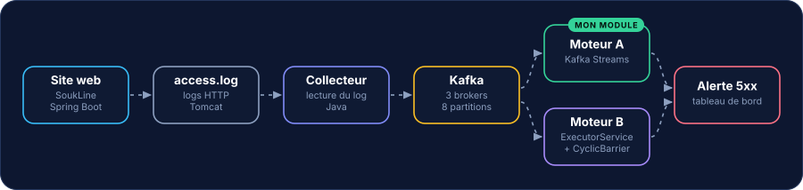
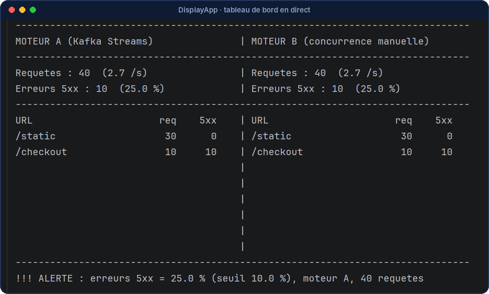
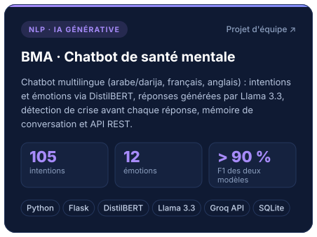
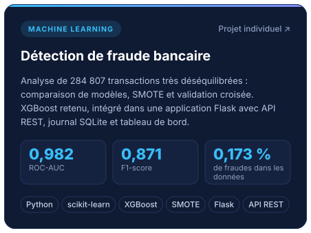
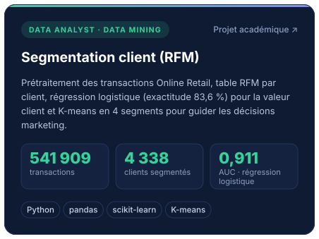
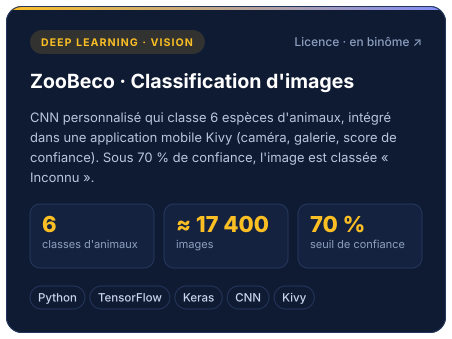
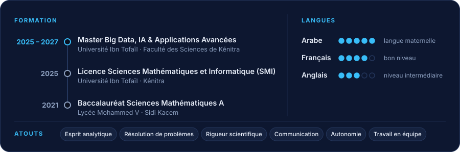

<picture>
  <source media="(max-width: 600px)" srcset="assets/header-m.svg">
  
</picture>

**Étudiant en Master Big Data, IA & Applications Avancées (2025–2027)** 
Université Ibn Tofaïl · Faculté des Sciences de Kénitra 🇲🇦

&nbsp;&nbsp;&nbsp;

## À propos

Je construis des systèmes de données **de bout en bout** : préparation des données, modèles de Machine Learning et de NLP, puis intégration dans une application (API REST Flask) ou dans un pipeline temps réel (Kafka).

Je cherche un **stage de PFE de 6 mois à partir de février 2027**, dans l'un de ces domaines :

- **Data Science, Data Analytics & BI** : nettoyage, exploration, segmentation client (RFM, K-means), indicateurs et tableaux de bord.
- **Machine Learning & Deep Learning** : classification, XGBoost, CNN, détection de fraude, modèles servis par API.
- **NLP & IA générative** : DistilBERT, Llama 3.3 via Groq, détection de crise, mémoire de conversation.
- **Big Data & Data Engineering** : Kafka, Kafka Streams, Hadoop, HBase, Hive, pipelines temps réel.

## Compétences

<picture>
  <source media="(max-width: 600px)" srcset="assets/skills-m.svg">
  
</picture>

## Projets à la une

### ⭐ SoukLine · détecter une panne web en temps réel

<a href="https://github.com/Bilal-Jellaoui/streaming-logs-kafka">
<picture>
  <source media="(max-width: 600px)" srcset="assets/soukline-flow-m.svg">
  
</picture>
</a>

- **Problème.** Quand un site tombe, les erreurs HTTP 5xx explosent dans les logs, mais personne ne les voit à temps.
- **Solution.** Un pipeline temps réel : logs Tomcat → collecteur Java → Kafka (3 brokers) → deux moteurs de calcul indépendants → tableau de bord et alerte.
- **Mon rôle.** Chef d'équipe (6 membres). Parser de logs (regex, normalisation des URL) et **Moteur A** en Kafka Streams (fenêtres de 5 s, temps d'événement lu dans le log). Le Moteur B, écrit à la main en Java (`ExecutorService`, `CyclicBarrier`), sert de point de comparaison.
- **Résultat.** Les deux moteurs donnent les mêmes totaux. Une panne simulée sur `/checkout` fait monter les erreurs 5xx à 25 % et déclenche l'alerte en quelques secondes.
- **Qualité.** Maven multi-modules, Pull Requests relues, tests JUnit, intégration continue GitHub Actions.

 Le tableau de bord détecte la panne : 10 requêtes sur 10 en erreur sur <code>/checkout</code>, soit 25 % de 5xx pour un seuil de 10 %.

[Voir le code](https://github.com/Bilal-Jellaoui/streaming-logs-kafka) · [Documentation détaillée](https://github.com/Bilal-Jellaoui/streaming-logs-kafka#readme)

### Autres projets à la une

## Autres travaux du Master

- **[Compression adaptative de signaux physiologiques](https://github.com/Bilal-Jellaoui/adaptive-physiological-signal-compression)** 
  Comparaison d'algorithmes de compression sur des signaux multi-capteurs (ECG, EEG, SpO2, respiration) et sélection adaptative de l'algorithme par une approche métaheuristique. Volume ciblé : 1 à 2 Go. 
  `Python` `Métaheuristique` `Traitement du signal`
- **[HBase · optimisation des charges et du stockage](https://github.com/Bilal-Jellaoui/HBase-Workload---Storage-Optimization)** 
  Analyse des métriques HBase, détection des points chauds (hotspots) et rééquilibrage des ressources. HDFS pour le stockage, Hive pour l'analyse et les rapports. Présentation orale en anglais. 
  `HBase` `HDFS` `Hive` `Hadoop`

## Parcours

<picture>
  <source media="(max-width: 600px)" srcset="assets/parcours-m.svg">
  
</picture>

## Contact

Ouvert aux échanges sur la Data Science, l'IA, le Machine Learning et les opportunités de stage.

**CV** [Télécharger (PDF)](https://github.com/Bilal-Jellaoui/Bilal-Jellaoui/raw/main/CV_Bilal_Jellaoui.pdf) · **Email** [bilaljellaoui@gmail.com](mailto:bilaljellaoui@gmail.com) · **LinkedIn** [bilal-jellaoui](https://www.linkedin.com/in/bilal-jellaoui) · **Portfolio** [bilal-jellaoui.github.io](https://bilal-jellaoui.github.io/)

Kénitra, Maroc · Disponible pour un stage PFE de 6 mois à partir de février 2027

